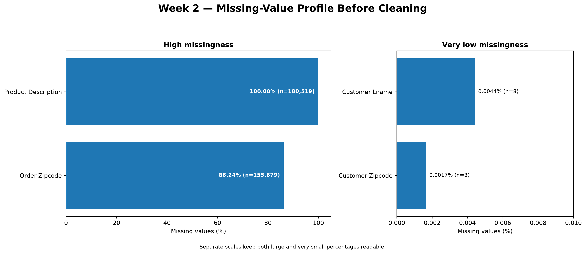
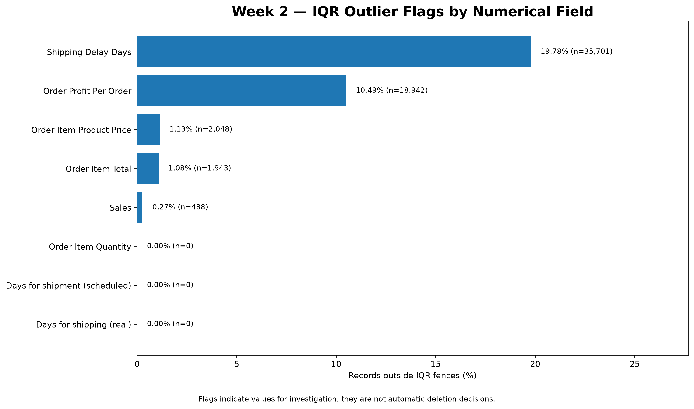
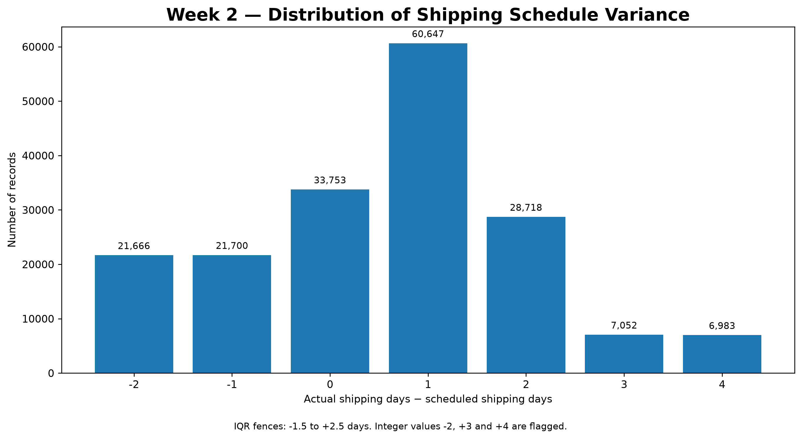
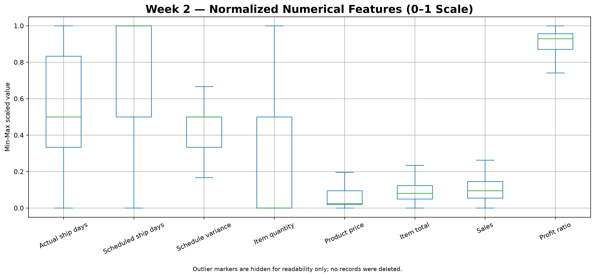

# Logistics Analytics Internship Projects — Weeks 1 & 2

**YuvaIntern | Logistics Data Analyst Intern**  
A Python-based logistics analytics portfolio covering strategic planning, KPI development, data-quality assessment, exploratory analysis, and reproducible data preprocessing.

[](https://www.python.org/) [](https://pandas.pydata.org/) [](https://matplotlib.org/) [](#project-contents)

## Project Overview

This repository documents two completed stages of a logistics data analytics internship project using the publicly available **DataCo SMART Supply Chain for Big Data Analysis** dataset. Week 1 focuses on strategic planning and exploratory analysis. Week 2 builds a reproducible preprocessing workflow that profiles missing data, documents cleaning decisions, flags potential outliers, normalizes numerical features, and validates the resulting files.

The analyses are descriptive and preprocessing-focused. They do **not** claim that a production predictive model or route-optimization system has been deployed.

## Dataset and Source

- **Dataset:** DataCo SMART Supply Chain for Big Data Analysis
- **Source:** [Mendeley Data](https://data.mendeley.com/datasets/8gx2fvg2k6/5)
- **Main source file:** `DataCoSupplyChainDataset.csv`
- **Inspected source dimensions:** 180,519 records × 53 columns
- **Exact duplicate rows found:** 0

The raw CSV is intentionally excluded from Git because of its size. Obtain it from the original source and put it in `data/raw/` before running the scripts. Do not commit the raw source dataset or the generated full-size cleaned and normalized CSV files.

## Week 1 — Strategic Planning and Data Exploration

Week 1 defined a retail supply-chain scenario, a KPI framework, and a roadmap for future logistics analytics. Python scripts inspect the dataset, prepare analysis fields, calculate KPIs, examine patterns by shipping mode and market, and generate report-ready visuals.

### Selected findings

| Metric | Observed result |
|---|---:|
| Records analyzed | 180,519 |
| Late-delivery records | 98,977 |
| Late-delivery rate (record-level) | 54.83% |
| On-schedule/early rate among non-cancelled records | 42.71% |
| Average actual shipping duration | 3.50 days |
| Average scheduled shipping duration | 2.93 days |
| Average schedule variance | +0.57 days |
| Cancellation rate | 4.30% |
| Average order value (order-level aggregation) | $502.71 |

### Week 1 visuals

**Delivery status distribution**


**Observed late-delivery rate by shipping mode**


**Observed late-delivery rate by market**


The rates are descriptive associations in this dataset and do not establish that shipping mode or market causes delivery delays.

## Week 2 — Data Collection, Cleaning, and Preprocessing

Week 2 turns the dataset into a documented preprocessing workflow and validates the saved outputs.

### Data-quality findings and treatment

| Check / field | Before cleaning | Treatment / result |
|---|---:|---|
| Source size | 180,519 rows × 53 columns | Kept a separate raw source file unchanged |
| Exact duplicate rows | 0 | No duplicate rows removed |
| `Product Description` missingness | 180,519 (100.00%) | Removed: no observed values for this analysis |
| `Order Zipcode` missingness | 155,679 (86.24%) | Removed: high missingness and not needed for selected analysis |
| `Customer Lname` missingness | 8 | Removed as an unnecessary direct identifier |
| `Customer Zipcode` missingness | 3 | Removed as an unnecessary fine-grained location identifier |
| Other columns removed | 4 | Removed customer email, password, first name and street fields because they were not required; the password-like field is not used in analytics |
| Rows removed for missing required fields | 0 | No rows removed for this rule |
| Rows removed for negative shipping durations | 0 | No rows removed for this rule |
| Final cleaned dataset | 180,519 rows × 46 columns | Eight columns removed and one engineered column (`Shipping Delay Days`) added |
| Missing cells in retained cleaned data | 0 | Verified after selected columns were removed |
| Duplicate rows in cleaned data | 0 | Verified |
| Delay calculation mismatches | 0 | `actual shipping days − scheduled shipping days` matched the engineered feature |

**Missing-data note:** the missing cells were not filled by mean/median imputation. They were concentrated in fields excluded from the selected analysis, and the retained dataset was verified to have no missing cells. This decision is appropriate for the defined scope, but would need reconsideration if those excluded fields were required for another analysis.

### IQR-based outlier review

The interquartile range (IQR) rule flags values outside `Q1 − 1.5 × IQR` and `Q3 + 1.5 × IQR`. Flags identify records for investigation; they are not automatic deletion decisions.

| Numerical field | Lower fence | Upper fence | Flagged records | Flagged % |
|---|---:|---:|---:|---:|
| Actual shipping days | -2.5 | 9.5 | 0 | 0.00% |
| Scheduled shipping days | -1.0 | 7.0 | 0 | 0.00% |
| Shipping delay days | -1.5 | 2.5 | 35,701 | 19.78% |
| Order item quantity | -2.0 | 6.0 | 0 | 0.00% |
| Order item product price | -174.99 | 424.98 | 2,048 | 1.13% |
| Order item total | -110.15 | 461.93 | 1,943 | 1.08% |
| Sales | -149.98 | 569.91 | 488 | 0.27% |
| Order profit per order | -79.70 | 151.50 | 18,942 | 10.49% |

For schedule variance, observed integer values of **−2, +3 and +4 days** fall outside the IQR fences. They were retained. The delay feature is derived from actual and scheduled shipment durations, so its strong alignment with `Delivery Status` is an internal consistency relationship, not an independent causal finding.

### Normalization and validation

Min-Max scaling was applied to eight numerical features using `(x − minimum) / (maximum − minimum)`. The resulting local modelling-preparation file contains 180,519 rows and eight normalized features. Validation confirmed that all values are within `[0, 1]`, there are no missing normalized values, and the row count matches the cleaned dataset.

For a future predictive model, scaling parameters must be fitted on training data only and then applied to validation/test data to avoid data leakage.

### Week 2 visuals

**Missing-value profile before cleaning**



**IQR outlier flags**



**Shipping schedule variance distribution**



**Normalized numerical features**



## Python Scripts

| Script | Purpose |
|---|---|
| `src/inspect_dataset.py` | Initial source-dataset inspection |
| `src/prepare_analysis.py` | Week 1 data preparation and descriptive KPI/chart outputs |
| `src/kpi_analysis.py` | Week 1 KPI validation |
| `src/exploratory_analysis.py` | Week 1 comparisons across shipping modes, markets, segments and regions |
| `src/create_report_charts.py` | Week 1 report visuals |
| `src/week2_data_preprocessing.py` | Week 2 profiling, cleaning decisions, IQR flags, normalization and output summaries |
| `src/week2_create_report_visuals.py` | Week 2 presentation-ready charts from verified CSV outputs |

## Repository Structure

```text
LogisticsAnalytics_Week1/
├── data/
│   ├── raw/                 # Raw CSV files are excluded from Git
│   └── processed/           # Small, privacy-safe evidence tables and summaries
├── outputs/
│   └── charts/              # Week 1 and Week 2 visualizations
├── report/
│   ├── Logistics_Data_Analytics_Week1_Report.docx
│   └── Logistics_Data_Collection_Cleaning_Preprocessing_Week2_Report.docx
├── src/                     # Python analysis and preprocessing scripts
├── .gitignore
├── LICENSE
├── README.md
└── requirements.txt
```

## How to Run

Use Windows PowerShell from the repository root.

```powershell
python -m venv .venv
.\.venv\Scripts\Activate.ps1
pip install -r requirements.txt
```

Place `DataCoSupplyChainDataset.csv` in `data/raw/`, then run:

```powershell
python .\src\inspect_dataset.py
python .\src\prepare_analysis.py
python .\src\kpi_analysis.py
python .\src\exploratory_analysis.py
python .\src\create_report_charts.py
python .\src\week2_data_preprocessing.py
python .\src\week2_create_report_visuals.py
```

The Week 2 visual-generation script uses the CSVs created by `week2_data_preprocessing.py`. Full-size cleaned and normalized CSVs are local outputs and should not be pushed to GitHub.

## Reports

- [Week 1 report](report/Logistics_Data_Analytics_Week1_Report.docx)
- [Week 2 report](report/Logistics_Data_Collection_Cleaning_Preprocessing_Week2_Report.docx)

## Limitations and Next Steps

- This is a descriptive analytics and data-preprocessing project, not a production deployment.
- IQR flags should be reviewed against transaction/business meaning before any rows are removed or capped.
- Some cleaning choices are specific to this analysis scope; excluded fields may be useful for other questions.
- Delivery status and schedule variance are tightly related; avoid leakage when building a model to predict delivery outcomes.
- Future work can add documented statistical testing, leakage-safe predictive modelling, explainability, and logistics optimization experiments.

## References

1. DataCo SMART Supply Chain for Big Data Analysis, Mendeley Data: https://data.mendeley.com/datasets/8gx2fvg2k6/5
2. pandas documentation: https://pandas.pydata.org/docs/
3. Matplotlib documentation: https://matplotlib.org/stable/
4. scikit-learn MinMaxScaler documentation: https://scikit-learn.org/stable/modules/generated/sklearn.preprocessing.MinMaxScaler.html
5. NIST/SEMATECH e-Handbook of Statistical Methods, exploratory data analysis and outlier detection: https://www.itl.nist.gov/div898/handbook/eda/section3/eda35h.htm

## Author

**Pravallika Gurubhagavatula**  
M.Sc. Data Science | Logistics Data Analyst Intern
